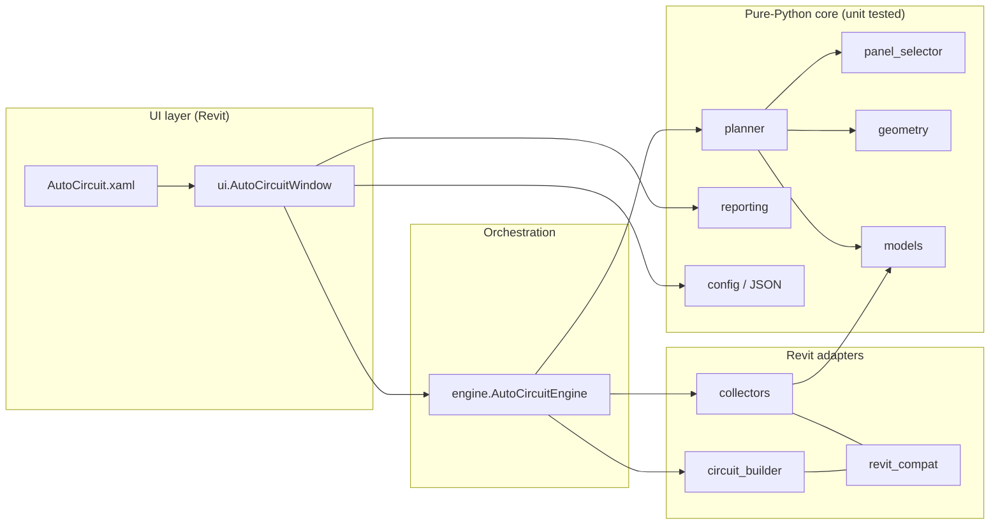
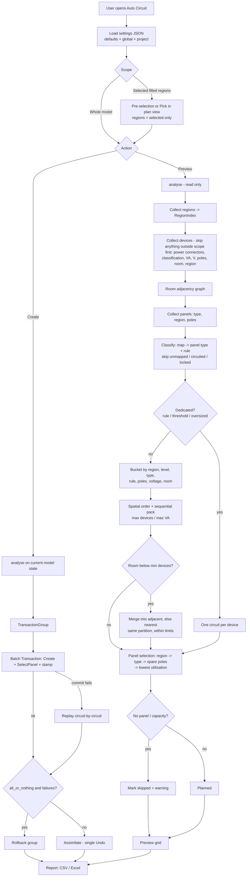

# ElecAutoCircuit — Design Document

PyRevit extension that creates electrical circuits automatically from rooms, load classifications, panel types, distribution regions and user-defined circuit rules.

Target: Revit 2021–2026 on pyRevit (IronPython 2.7 engine, the pyRevit default). Revit 2019–2020 is best-effort through the compatibility layer. The pure-Python core also runs under CPython 3 for testing.

---

## 0. Assumptions

1. **"Field Region" = Revit `FilledRegion`** (2D, view-specific). A filled region is a distribution zone when its *type name* starts with a configurable prefix (default `ELEC-ZONE`). The zone name is taken from the region's **Comments** (or the type name). The zone applies to the level of the plan view it is drawn in (`View.GenLevel`). Turning off *level filter* lets one drawing apply to all levels.
   *Recommendation:* for long-lived projects, **Areas on a dedicated Area Scheme** make better zones. They are model elements, level-bound and schedulable. The `Region` model is geometry-agnostic, so swapping the collector is a small change.
2. **Panel type** (LP / PP / ACP / ELP …) is read from an instance or type parameter named `Panel Type`. If that is empty, a longest-match panel-name prefix map is used (`LP-GF-01` → LP, `MCP-` → ACP).
3. **Load, voltage and poles** come from connector-associated family parameters (`Apparent Load`, `Voltage`, `Number of Poles` — names configurable). Power and voltage specs are converted from internal units. Plain-number parameters are taken as VA or V as-is.
4. **Already-circuited devices are never touched.** A power connector can belong to only one circuit.
5. **Grouping never mixes** region, level, panel type, circuit rule, pole count or voltage. Mixing these either breaks design intent or is rejected by Revit.
6. **Default limits are NEC-120 V flavoured, as specified.**
   - 1800 VA = 15 A × 120 V. For 20 A continuous loads, NEC 210.19(A)/210.20(A) gives 1920 VA.
   - Receptacles are 180 VA per yoke (NEC 220.14(I)).
   - The fixture-count caps (12 / 10) are design conventions, not code requirements.
   - For IEC / BS 7671 projects at 230 V, raise the VA limits to match the protective device (16 A ≈ 3680 VA before derating) and your diversity policy.
7. **Panel spare capacity** = *Max #1 Pole Breakers* − Σ poles of assigned circuits. An optional utilisation cap (e.g. 80 %) reserves spares.
8. **Worksharing:** panels and devices owned by another user are excluded and reported. Nothing is borrowed silently.


## 0b. Circuiting scope: selected filled region(s) only

| Mode | What is read and circuited |
|---|---|
| **Whole model** | Every device in the configured categories. Zones come from filled regions whose type name starts with the prefix. |
| **Selected filled region(s) only** | Only the rooms, devices and panels inside the filled regions the user selected. Everything else is **not read, not circuited and not reported**. Each selected region is a zone (the type prefix is ignored). |

**How to select.** Either select the filled region(s) in a plan view before clicking *Auto Circuit* (pre-selection switches the scope on automatically), or use *Execution → Pick Filled Region(s) in View…*. The window closes, you pick in the active plan (Finish / Esc), and the window reopens with every setting preserved. Selections are stored by `UniqueId` in the project settings file. They are deliberately not stored in the global "last used" file, because ids from one project mean nothing in another.

**What counts as inside:**
- **Devices.** The device location is inside the region's boundary (holes respected), on the region's level. Optionally, *room location point* mode uses the device's room location instead, so a room straddling the boundary is either taken whole or skipped whole.
- **Rooms.** Only rooms of in-scope devices are resolved. Room merging can only combine rooms inside the scope.
- **Panels.** A panel is used if it is located inside a selected region, **or** if it is listed for that region under *Region Settings → OverridePanels*. The override covers the common case of a DB in an electrical room just outside the zone.
- **Levels.** A filled region applies to the level of the plan it was drawn in. Untick *Region applies only to its view's level* to apply the selection to every level (stacked typical floors).

**Performance.** In device mode, a `BoundingBoxIntersectsFilter` built from the union of the selected regions discards out-of-area elements inside Revit, before any parameter, room or classification work. The classification probe and all transactions therefore touch only in-scope devices.

## 1. Revit API limitations and how the tool handles them

| # | Limitation | Handling |
|---|---|---|
| 1 | **Load Classification is a connector property.** It is not exposed on project instances. | **Taken from the project.** For each family type, one instance is placed on a temporary circuit (`ElectricalSystem.Create`) inside a transaction that is **always rolled back**, and `ElectricalSystem.LoadClassifications` is read. This is exactly what Revit assigns in this project. One transaction per run, cached per type, model unchanged. Optional fallbacks (off by default): named parameter, family document, category map. Names not defined in the project are reported. |
| 2 | **Apparent load in the family doc reflects only the current type.** | Load is read from project instance/type parameters, never from the family doc. |
| 3 | **`FamilyInstance.Room` often returns `null` for ceiling-hosted lights** above the room's upper limit, and for rooms that live in the architectural link. | Probe point = level elevation + 300 mm → `GetRoomAtPoint`. Then linked rooms (point transformed by `GetTotalTransform().Inverse`). Then MEP Spaces. |
| 4 | **No API for "adjacent room".** | Adjacency = shared boundary element from `GetBoundarySegments()`. Nearest centroid within a max distance is the fallback. |
| 5 | **Panel compatibility can't be predicted reliably.** Distribution system, voltage and poles mismatches only surface in `SelectPanel()`. | After `SelectPanel`, `BaseEquipment` is verified. If the panel rejects the circuit, ranked alternate panels are tried inside the same transaction. |
| 6 | **Panel-schedule spares/spaces are not reflected** in assigned systems. | Documented. Use the utilisation cap to keep headroom. |
| 7 | **`FilledRegion` is view-specific and 2D.** | Point-in-polygon in plan XY, restricted to the view's level. Holes are supported (even-odd rule). Nested zones resolve to the smallest one. |
| 8 | **API churn across versions** (`ElementId.Value`, `UnitTypeId`, `GetDataType`, `GetElectricalSystems`, `GetAssignedElectricalSystems`, `ElectricalSystem.Create`). | Isolated in `revit_compat.py`. |
| 9 | **`EditFamily` cannot run while a transaction is open**, and is slow. | It runs only during the read-only analysis phase, is cached, and can be switched off. |
| 10 | **Elements in model groups / secondary design options** frequently fail circuiting. | Secondary design options are skipped. Group failures are isolated per circuit and reported. |
| 11 | **Some Revit errors appear only at commit time.** | A failure preprocessor captures warnings, and errors force `ProceedWithRollBack` (no modal dialogs). A failed batch is replayed one circuit at a time. |

---

## A. Solution architecture



The design is layered so that **all decision logic lives in pure Python** and is testable without Revit. The Revit layer only extracts data (collectors) and applies the plan (builder). The UI talks only to the engine, the config module and the reporter.

| Module | Responsibility |
|---|---|
| `config` | Defaults, deep-merge of user/project JSON, validation, save/export/import |
| `logger` | Daily log file in `%APPDATA%\ElecAutoCircuit\logs` |
| `mapping` | Syncs the mapping table with the project's Electrical Load Classifications; suggestions for new ones |
| `models` | `FixtureInfo`, `PanelInfo`, `RoomNode`, `PlannedCircuit`, `CircuitPlan` |
| `geometry` | Point-in-polygon, `Region`, `RegionIndex`, spatial ordering |
| `planner` | Classification mapping, dedicated rules, bucketing, packing, room merging |
| `panel_selector` | Region/type/spare/utilisation panel choice, region overrides |
| `reporting` | Report sheets, CSV (UTF-8 BOM), native `.xlsx` |
| `selection` | Filled-region pick filter, pre-selection, pick-and-reopen loop |
| `revit_compat` | Version shims, unit conversion, system access |
| `collectors` | Fixtures, rooms (host / link / spaces), regions, panels |
| `circuit_builder` | `ElectricalSystem.Create`, `SelectPanel`, transactions, failure handling |
| `engine` | `analyse()` (read-only preview) / `execute()` |
| `ui` | WPF window, DataTable-bound grids |

## B. Workflow diagram



## C. PyRevit folder structure

```
ElecAutoCircuit.extension/
├── ElecAutoCircuit.tab/
│   ├── bundle.yaml
│   └── Circuiting.panel/
│       └── AutoCircuit.pushbutton/
│           ├── script.py            # entry point
│           ├── AutoCircuit.xaml     # WPF UI
│           ├── bundle.yaml
│           └── icon.png
├── lib/autocircuit/                 # pyRevit adds <ext>/lib to sys.path
│   ├── __init__.py  config.py  logger.py  models.py  geometry.py
│   ├── planner.py   panel_selector.py  reporting.py
│   ├── mapping.py   selection.py
│   ├── revit_compat.py  collectors.py  circuit_builder.py  engine.py  ui.py
├── config/default_settings.json
├── tests/test_core.py               # 40 unit tests, run outside Revit
└── docs/DESIGN.md
```

## D. Detailed algorithm

```
analyse():
  regions   ← FilledRegions whose type starts with prefix → loops (tessellated XY), level
  index     ← RegionIndex(regions sorted by area asc)          # nested zones: smallest wins
  for each FamilyInstance in configured categories:
      skip secondary design options, panels, transformers, elements without a power connector
      cls   ← PROJECT: temp circuit per family type → ElectricalSystem.LoadClassifications (rolled back)
              fallbacks (optional): param | family connector | category map
  mapping ← sync(saved map, project ElectricalLoadClassification names, suggestions)
      VA, V ← spec-aware param read (internal → VA / V); poles ← param or 1
      room  ← Room[phase] | GetRoomAtPoint(level + probe) | linked rooms | Spaces
      region← index.locate(x, y, level) or "<No Region>"
      flags ← already circuited, owned by other user
  rooms.adjacency ← rooms sharing a boundary element id
  panels ← panelboards: name, type (param | prefix), max poles, used poles, region (location or override)

plan():
  for f in devices:
      skip if circuited / locked / no classification / unmapped / rule missing
      (panelType, rule) ← map(cls)
      dedicated ← rule.dedicated OR VA > rule.dedicated_above_va OR VA > rule.max_load_va (+warning)
  dedicated devices → 1 circuit each
  shared devices → buckets[(region, level, panelType, rule, poles, V, room)]
  for bucket: order ← nearest-neighbour chain (serpentine grid if > 400 devices)
              cut sequentially when count == max_devices or VA + next > max_load_va
  if merging enabled:
      per partition (bucket key without room):
        repeat:
          small ← circuits with count < min AND (room total < min OR merge tails)
          target ← best fitting circuit: adjacent room first, then nearest centroid ≤ max distance
          merge small → target (record "rooms merged"), until no merge possible
  panel selection (dedicated / multi-pole / largest first):
      candidates ← panels of panelType, not locked
      pool ← in-region candidates with free poles ≥ circuit poles and utilisation_after ≤ cap
      if empty and cross-region allowed → out-of-region pool (+warning)
      if empty → NoPanel / NoCapacity (+warning, circuit skipped)
      choose min(level preference?, utilisation, distance, name); reserve poles; keep alternates
```

**Why sequential cuts instead of bin-packing?** First-fit-decreasing packs circuits more tightly, but it scatters physically distant devices onto the same circuit, which means long home runs. Sequential cuts along a nearest-neighbour chain give compact, cable-efficient circuits at the cost of an occasional partially filled circuit. Merging then cleans up the tiny ones.

## E. Revit API design

| Purpose | API |
|---|---|
| Device collection | `FilteredElementCollector.WherePasses(ElementMulticategoryFilter)`, `OfClass(FamilyInstance)` |
| Power connectors | `FamilyInstance.MEPModel.ConnectorManager.Connectors`, `Connector.Domain == DomainElectrical`, `Connector.ElectricalSystemType` |
| Existing circuits | `MEPModel.GetElectricalSystems()` (2021+) / `.ElectricalSystems` |
| Load classification | Project list: `FilteredElementCollector.OfClass(ElectricalLoadClassification)`. Per device type: `ElectricalSystem.Create` in a rolled-back `Transaction` → `ElectricalSystem.LoadClassifications` |
| Units | `UnitUtils.ConvertFromInternalUnits(v, UnitTypeId.VoltAmperes / Volts)`; spec check via `Definition.GetDataType()` |
| Rooms | `FamilyInstance.Room[Phase]`, `Document.GetRoomAtPoint`, `RevitLinkInstance.GetLinkDocument()/GetTotalTransform()`, `GetSpaceAtPoint`, `SpatialElement.GetBoundarySegments` |
| Regions | `FilledRegion.GetBoundaries()`, `Curve.Tessellate()`, `View.GenLevel` |
| Panels | `RBS_ELEC_PANEL_NAME`, `RBS_ELEC_MAX_POLE_BREAKERS`, `FAMILY_CONTENT_PART_TYPE`, `ElectricalEquipment.GetAssignedElectricalSystems()`, `ElectricalSystem.PolesNumber` |
| Creation | `ElectricalSystem.Create(doc, IList<ElementId>, ElectricalSystemType.PowerCircuit)`, `ElectricalSystem.SelectPanel(FamilyInstance)`, `BaseEquipment`, `CircuitNumber` |
| Stamping | `RBS_ELEC_CIRCUIT_NAME` (Load Name from template), `ALL_MODEL_INSTANCE_COMMENTS` = `AutoCircuit <run id>` |
| Transactions | `TransactionGroup` → `Transaction` batches → `IFailuresPreprocessor`; `Assimilate` / `RollBack` |
| Worksharing | `WorksharingUtils.GetCheckoutStatus` |

Lighting circuits use `ElectricalSystemType.PowerCircuit`. Revit has no separate lighting system type; lighting vs power is a matter of classification and panel.

## F. Source code

All source code is in `lib/autocircuit/` and `script.py`. See the module table in section A.

## G. WPF UI

`AutoCircuit.xaml` has four tabs:

- **Circuit Rules:** min devices before merging, merging on/off, tail merging, max distance, utilisation cap, level preference, room/classification detection options, and an editable rules grid.
- **Load Classification Mapping:** editable grid, add/remove, and import of classification names found in the model.
- **Region Settings:** type prefix, name source, level filter, cross-region toggle, and a scan grid showing each region's levels, the panels located inside it, and editable panel overrides.
- **Execution:** Preview, Create, Export CSV/Excel, Select uncircuited, all-or-nothing, and auto-report folder. A results grid shows every circuit's status.

Settings can be saved, exported and imported as JSON so a team can share one standard.

## H. Error handling strategy

| Level | Mechanism |
|---|---|
| Settings | `config.validate()` runs before every Preview/Create/Save. Corrupt JSON files fall back to defaults. Writes are atomic via temp-file rename. |
| Collection | Per-element try/except. A bad element is logged and skipped, never fatal. Unreadable families are cached as "no classification". |
| Planning | Every skip carries a reason (unmapped, no classification, circuited, locked, no panel, no capacity) and appears in the *Uncircuited* sheet. |
| Creation | Batched transactions. Warnings are captured and suppressed. Errors trigger `ProceedWithRollBack`. A failed batch is replayed one circuit at a time to isolate the culprit. Rejected panels fall back to alternates. |
| Run | `TransactionGroup` gives a single Undo. A fatal exception rolls back the whole group. The optional all-or-nothing mode rolls back on any failure. |
| UI | Every handler is wrapped (`@guarded`): exceptions are logged with a stack trace and shown to the user with the log path. The window stays open. |
| Traceability | Each run has an ID stamped in circuit Comments (filterable to review or delete a run). The daily log contains stage timings. |

## I. Test cases

**Unit tests** (`python -m unittest discover -s tests -v`, 40 tests, all passing):

| Area | Case | Expected |
|---|---|---|
| Packing | 30 lights × 100 VA, one room | 12 + 12 + 6 |
| Packing | 10 lights × 300 VA | VA-limited: 6 + 4 |
| Packing | 10 receptacles × 180 VA | 1 circuit (limit 10) |
| Packing | Mixed poles/voltages | never share a circuit |
| Dedicated | 3 HVAC units | 3 circuits on ACP |
| Dedicated | HVAC override (not dedicated, max 4) | 1 circuit |
| Dedicated | Equipment 2000 VA + 2 × 500 VA | 1 dedicated + 1 shared |
| Dedicated | Light 2500 VA > 1800 VA | own circuit + warning |
| Merging | Room A (2) adjacent to room B (3), min 3 | merged; A reported |
| Merging | Disabled / non-adjacent beyond 15 m / different class / different region / would exceed limits | not merged |
| Panels | PP at 50 % vs 19 % | lower utilisation chosen |
| Panels | Two equal PPs, 4 circuits | 2 + 2 balanced |
| Panels | Full panel / 80 % cap reached | *No Capacity* |
| Panels | ELP not in model | *No Panel* |
| Regions | Device in Z2, panel only in Z1 | *No Panel*; with cross-region → planned + warning |
| Regions | Override `Z7: [pp-9]` | panel serves only Z7 (case-insensitive) |
| Worksharing | Locked panel | excluded |
| Scope | Selected mode with no region | validation error (allowed while picking) |
| Scope | Panels inside / outside / outside-but-overridden | inside and overridden kept |
| Scope | Device outside region or on another level | not located (skipped by collector) |
| Scope | Global settings file | selection not persisted globally, kept per project |
| Classification | Unmapped, empty, already circuited, case/wildcard | skipped with reason / matched |
| Geometry | Hole, nested zones, level filter | correct containment |
| Config/Report | Defaults valid, validation errors, deep merge, CSV + XLSX (6 sheets) | pass |

**Integration tests in Revit** (recommended sample model):

1. Host rooms + ceiling lights above the room's upper limit → all resolved via probe.
2. Rooms only in an architectural link (moved/rotated link) → resolved, names tagged `[link]`.
3. Family without an associated Load Classification parameter → classified via family connector; disable the option → category fallback.
4. 120/208 V panel with 230 V devices → `SelectPanel` rejected → alternate panel used or circuit reported *Failed*; nothing else rolled back.
5. Panel borrowed by another user → excluded with warning.
6. 5,000-device model → Preview < 60 s (see J); Create with batch 50; a single Ctrl+Z undoes the run.
7. All-or-nothing with one forced failure → model unchanged.
8. Re-run on the same model → already-circuited devices skipped, 0 duplicates.
9. Pre-select two filled regions on Level 02 → only Level 02 devices inside them are circuited; the report's *Devices outside scope (ignored)* is non-zero; no circuits elsewhere.
10. Pick in a 3D view → the tool asks for a plan view and keeps the previous selection.
11. Room crossing the region edge with *room location point* inclusion → whole room in or out.

## J. Performance recommendations

1. **Single collector pass per category set.** Use `ElementMulticategoryFilter` + `OfClass` (quick filters first).
2. **Cache everything that repeats:** family classification (per family), level elevations, room nodes and boundaries (once per room), level names.
3. **Classification probing is per family type, not per device.** A project with 60 device types needs 60 temporary circuits in one rolled-back transaction. Keep `read_classification_from_family` off; `EditFamily` is ~0.2–1 s per family.
4. **Batched transactions** (default 50 circuits) instead of one per circuit. Regeneration and commit cost dominate. Failures fall back to per-circuit replay automatically.
5. **Spatial ordering is O(n²) only per room.** Buckets over 400 devices switch to O(n log n) serpentine ordering.
6. **Region lookup** uses a bounding-box reject before point-in-polygon, with regions sorted by area.
7. **Preview first on large models.** Preview is read-only and fast. Create re-analyses to guarantee consistency.
8. **Worksharing:** borrow panels before a run (or run with the panels' worksets owned) to avoid per-element checkout failures. Sync afterwards.
9. **Unload unused links.** Room lookup iterates only loaded links that contain rooms.
10. **Split very large runs by level or region** (set the region prefix or level-filtered regions) if a single run exceeds ~10,000 devices, to keep Undo size and memory manageable.

---

## Configuration reference (`config/default_settings.json`)

| Key | Meaning |
|---|---|
| `general.min_fixtures_before_merge` | Rooms with fewer devices (per partition) are merged |
| `general.merge_partial_tails` | Also merge the leftover circuit of large rooms |
| `general.max_merge_distance_m` | Distance cap for non-adjacent merges (0 = unlimited) |
| `general.allow_cross_region` | Allow out-of-region panels when no in-region panel fits |
| `general.max_panel_utilization_pct` | Keep spare ways, e.g. 80 |
| `general.panel_type_parameter` / `panel_name_prefix_map` | Panel type detection |
| `general.*_parameter_names` | Parameter names for classification, load, voltage, poles |
| `general.load_name_template` | e.g. `{rule} - {rooms}`; placeholders: rule, rooms, panel_type, region, count |
| `general.transaction_batch_size`, `all_or_nothing` | Transaction behaviour |
| `regions.*` | Filled-region prefix, name source, level filter |
| `scope.mode` | `all` or `selected_regions` |
| `scope.selected_region_ids` | UniqueIds of the selected filled regions (project file only) |
| `scope.inclusion` | `fixture` (device location) or `room` (room location point) |
| `circuit_rules.<name>` | `max_devices`, `max_load_va`, `dedicated`, `dedicated_above_va` |
| `classification_map[]` | Rebuilt from the project on every open: `classification` → `panel_type`, `rule`; blank panel type = excluded |
| `classification_suggestions[]` | Keyword patterns that pre-fill panel type/rule for classifications seen for the first time |
| `general.probe_classification_from_project` | Read each device's classification from the project (default true) |
| `general.read_classification_from_family`, `use_category_fallback` | Optional fallbacks (default false) |
| `category_fallback_classification` | Category → classification when nothing else is found |
| `region_panel_overrides` | `{region: [panel names]}` |

## Installation

1. Copy `ElecAutoCircuit.extension` to a folder, and add that folder in pyRevit → Settings → Custom Extension Directories. Alternatively, drop it into `%APPDATA%\pyRevit\Extensions`.
2. Reload pyRevit. The **ElecAutoCircuit** tab appears with **Auto Circuit**.
3. In plan views, draw zones with a filled region type named `ELEC-ZONE…` and put the zone name in Comments.
4. Make sure panels have *Panel Type* (or prefix names) and *Max #1 Pole Breakers* set.
5. Optional: select the filled region(s) of the area to circuit before starting (or pick them in the tool). Only that area is processed.
6. Run Preview, review the grid and report, then run Create Circuits.
